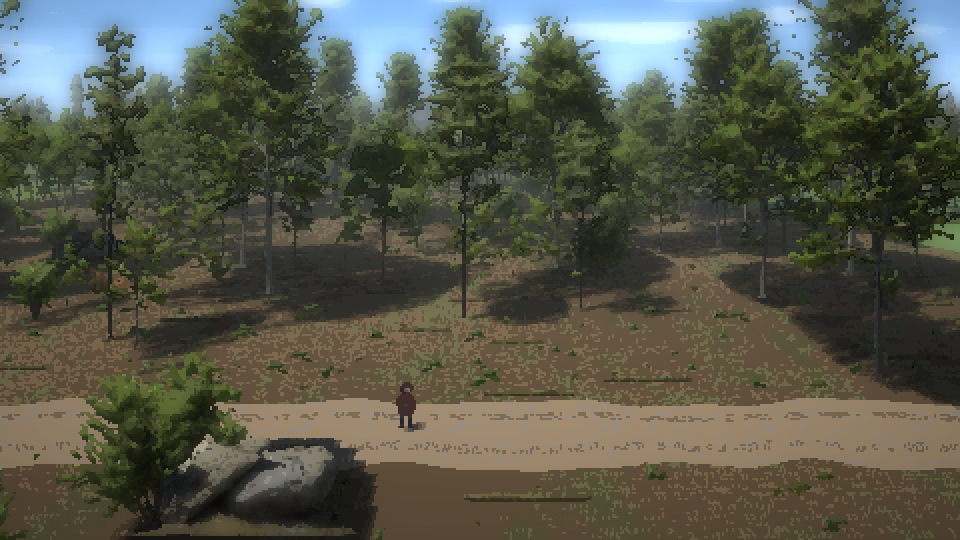
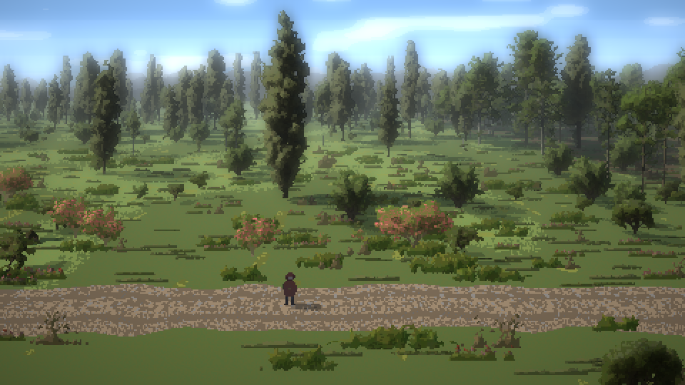
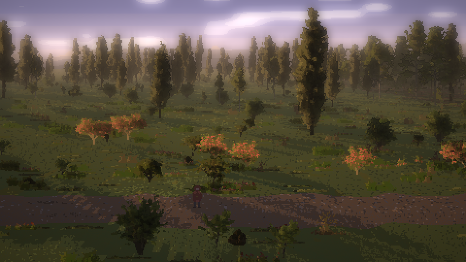
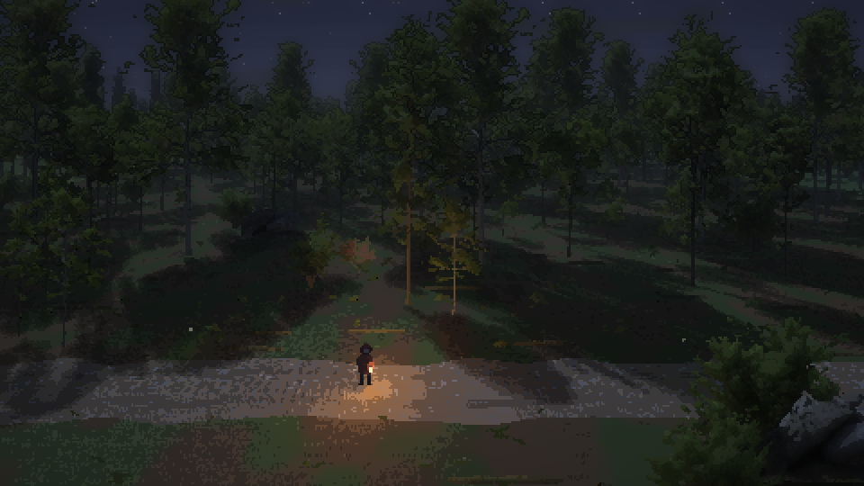
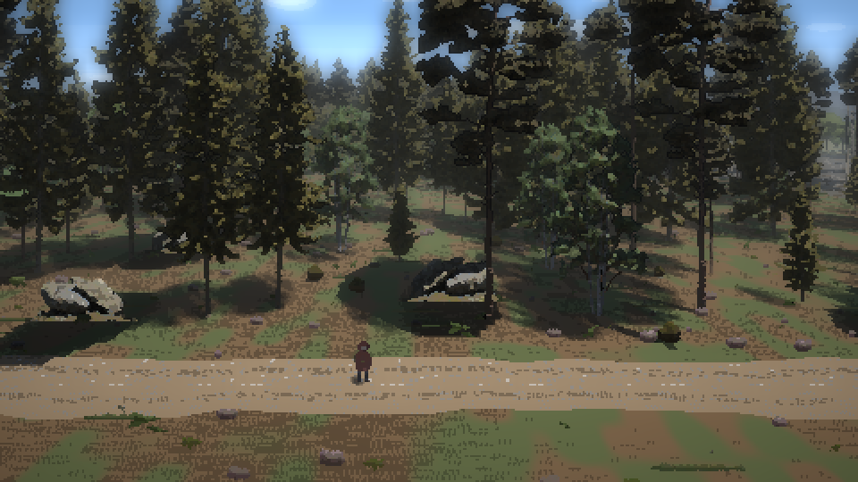

# Lanternwood

**A pixel-art world lit by ray-traced light.** Walk a 700 m trail through meadows, beech woods,
birch glades, spruce heights and a burnt ridge, from dawn to a lantern-lit night. Every tree,
fern and blade of grass is a photoscanned plant baked into a pixel sprite that still knows its
own 3D shape, so the light falls on it the way it would on the real thing.

### ▶ [Play it in your browser](https://samg-coder.github.io/lanternwood/)



|  |  |
|---|---|
| **Hearthmeadow**: poppies, dandelions and wild grass under aspens and poplars | **Dawn**: the sun behind the trees, glowing crowns and long shadows toward you |
|  |  |
| **Night**: moonlight, and a lantern whose light is traced through the leaves | **Spruce Heights**: spruce and Baltic pine over boulders and heather |

## Controls

| Key | Action |
|---|---|
| **A / D** or **← / →** | Walk |
| **W / S** or **↑ / ↓** | Move along the trail (toward or away from the camera) |
| **Space** | Jump |
| **Shift** | Run |
| **[ / ]** | Time of day back / forward |
| **T** | Pause or resume time |
| **F** | Fullscreen |
| **E** | Gather from the plant, log or rock in reach (**Tab** picks another) |
| **I / K / C** | Journal: bag, character and skills, crafting |
| **H** | Settings: time of day, look, depth of field, bloom, haze, wind, light quality |

**On a phone or tablet:** turn it sideways, then tap *Begin the walk*. The game goes fullscreen
and locks to landscape where the browser allows it. Drag anywhere on the left half to walk
(push to the edge to run). Use **⤒** to jump, **Run** to toggle running and **Gather** when a plant or rock is in reach
(tap the prompt to pick another). Touch devices
start on *Balanced* light quality, which shortens the traced rays.

Needs a browser with WebGL2: any current desktop or mobile browser.

## The RPG

- **Classless.** There's no class to pick. You become what you practise: every skill levels from
  use, up to 50, and your total level is the sum of them all. What you carry (staff, bow, maul,
  buckler) decides how you play.
- **Professions:**

  | Gathering | Crafting |
  |---|---|
  | Herbalism | Alchemy |
  | Forestry | Woodworking |
  | Stonecutting | Masonry |

  Agility trains as you walk, run and jump.
- **The world is the resource map.** The poppies, bilberries, ferns, heather, fallen logs, trees
  and boulders along the trail are gathering nodes: 11 herbs, 18 woods and 2 stones. Spent plants
  and rocks vanish and grow back, and their traced shadows go with them. Trees need rest between
  harvests. The southern boulders are sandstone.
- **Crafting:** 20 recipes, including potions, bows, staves, a buckler, a maul, a waystone
  trinket, and better tools that gather faster.
- **Your character:** made in a character creator (build, skin, hair, clothes, cloak), drawn as a
  procedural pixel paper-doll. It's lit by the same traced light as the forest, with idle, walk,
  run, jump, gather, chop, quarry and craft animations. Gear you equip shows on the sprite.
- **Saves** in your browser.
- **Ready for multiplayer.** Every change to a character goes through one function,
  [`docs/js/state.js`](docs/js/state.js) `act()`. It has no DOM and runs in Node
  (`node tools/test_state.js`), so a future MMO gateway can run the same rules as the authority,
  with [asm-mmo-server](https://github.com/SamG-Coder/asm-mmo-server) handling movement and visibility.

## What makes it different

Most pixel-art games paint their light by hand. Lanternwood computes it.

- **Sprites that remember their shape.** Each sprite carries a full G-buffer, not just colour:
  per-pixel normal, the depth of the plant's front *and* back surface, ambient occlusion, sky
  visibility, leaf coverage and how spread the leaf normals are. Every map shares one pixel
  grid, so light lands on exactly the pixels the art has.
- **Light is traced, every frame.** Each pixel marches toward the sun, the moon or the lantern
  through its own sprite's depth slab, which gives a tree real self-shadowing inside its
  crown. It then marches through a world-space **canopy volume** built from every tree's crown
  shape. Trees above the top of the screen still shade the forest floor, sunlight comes
  through the gaps as dappled patches, and trunks cast long shadows at sunset.
- **Leaves let light through.** Light through the leaves is scattered forward, so a tree with
  the sun behind it glows at its thin edges and stays dark at its core.
- **It still looks like pixel art.** The lit colour is snapped to brightness bands. Pixels that
  stand alone in their band are merged into clusters, and silhouettes get a selective outline.
- **A diorama camera.** A real perspective camera views the layers: huge foreground ferns, the
  trail, rows of forest fading into haze, distant mountain ridges. Sprites are pre-baked at
  the size their distance needs, so nothing is ever resized at runtime. Depth of field, bloom
  and vignette finish the picture.
- **A living world.** A day and night cycle, wind that bends trunks pixel by pixel, gusts that
  roll across the trail, fluttering leaves, and fireflies after dark.

It runs in about 3 ms a frame at 480×270 on a desktop GPU, then scales up with crisp pixels.

## How it is made

```
Photoscanned plants  ->  SmartImposter       ->  tools/bake_world.py      ->  tools/pack.mjs  ->  docs/data/world.rtp  ->  the game
(Quixel Megascans,       ray-traced impostor     world layout + pixel         RTPack codec        one 3.7 MB file          decodes in a worker,
 Megaplants)             atlases (GPU, offline)  sprite G-buffers at                                                       lights on the GPU
                                                 true scale
```

1. **[SmartImposter](https://github.com/SamG-Coder/SmartImposter)**, a hardware ray-traced
   Rust/Vulkan renderer, bakes every plant (up to half a billion triangles each) into a
   compressed atlas: albedo, normal, depth, coverage, AO, sky visibility and normal spread
   from 144 directions.
2. **`tools/bake_world.py`** lays out the world (`tools/world_gen.py`: regions, species mixes,
   densities, the camera). It reads each plant's side view and its opposite view straight from
   the SmartImposter cache, which gives the front and back surface of every crown. It then
   resamples everything to an exact pixels-per-metre scale, using the real plant sizes from the
   mesh packs.
3. **`tools/pack.mjs`** packs the world into **RTPack**, the game's own distribution format (below).
4. **`docs/`** is the game: plain HTML and WebGL2, no build step, no dependencies.

### RTPack: the distribution format

The site serves a single file, `docs/data/world.rtp`, built for sprite G-buffers.
[`docs/js/rtpack.js`](docs/js/rtpack.js) is the whole codec. It both packs (in Node) and unpacks
(in the browser), and both directions run the same code.

| | Size |
|---|---|
| Raw sprite maps (913 sprites) | 76.4 MB |
| PNG | 8.5 MB |
| deflate | 7.2 MB |
| **RTPack** | **3.7 MB** |

- **Only what is there.** Only 11% of sprite pixels are inside a plant. The alpha mask is coded
  as context-modelled bits, and only pixels inside it are stored.
- **Only what the shader needs.** Normal Z, constant channels and the unused channels are
  dropped and rebuilt on load. Data channels are quantized to the precision the banded
  lighting can show.
- **Predict, then code the surprise.** Colour is stored as G, R−G and B−G. Every value is
  predicted from its neighbours with the median edge predictor (as in JPEG-LS), and only the
  error is coded.
- **Adaptive range coding.** An LZMA-style binary range coder, with contexts from the local
  gradient and the previous channel's error. The world layout and catalog use an order-1
  byte coder.
- **Independent blocks.** Each sprite decodes on its own, in a background worker, as it comes
  into view.

## Building the world yourself

You need [SmartImposter](https://github.com/SamG-Coder/SmartImposter) with its asset library,
Python 3 (numpy, Pillow) and Node.

```powershell
# 1. bake every plant once in SmartImposter (the first globe start bakes all 207 variants)
D:\SmartImposter\target\release\smart_imposter.exe --globe --frames 2 --shot shots/_bake_all.png

# 2. lay out the world, bake its sprites (into bake/, private) and pack them (about 15 s)
python tools/bake_world.py

# 3. play locally
python tools/devserver.py      # then open http://127.0.0.1:8765/docs/
```

Edit `tools/world_gen.py` to change the world, then bake again. After changing anything in `docs/`
by hand, run `python tools/stamp.py` before committing. It puts content hashes on the script, worker
and pack URLs, so browsers never mix cached old files with a new deploy. The bake runs it for you.

| Path | What it is |
|---|---|
| `docs/` | The game (served by GitHub Pages) |
| `docs/js/game.js` | Renderer: G-buffer, traced lighting, stylize, post, player, world |
| `docs/js/rtpack.js` | The RTPack codec |
| `tools/world_gen.py` | World layout: regions, species, densities, camera |
| `tools/bake_world.py` | SmartImposter cache → pixel sprite G-buffers → pack |
| `tools/bcread.py`, `tools/mtree.py` | Readers for SmartImposter's BC atlas cache and mesh packs |
| `tools/render2d.py`, `viewer/` | The first prototype: one lit tree, and a small lighting test scene (needs a local bake) |

## License

The **code** (game, codec, tools, shaders) is released under the [MIT License](LICENSE).

The **plant, tree, grass, flower and rock art** packed in `docs/data/world.rtp` is *not* covered
by that license. It is derived from **Quixel Megascans and Megaplants**, © Epic Games, Inc.
and its licensors, and is used under the [Fab EULA](https://www.fab.com/eula) for use in this
game only. It may not be extracted or used in other projects. See [docs/NOTICE.md](docs/NOTICE.md).
To build your own world with these tools, use assets you hold a license for.
